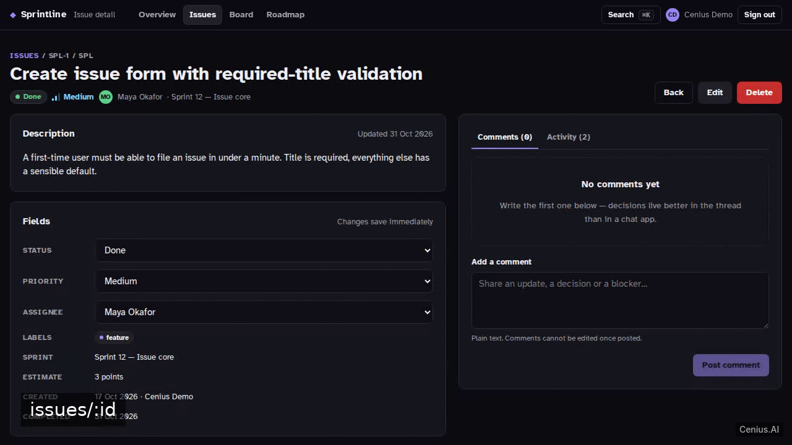
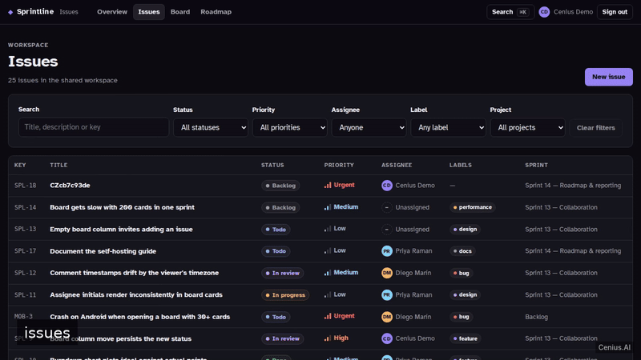
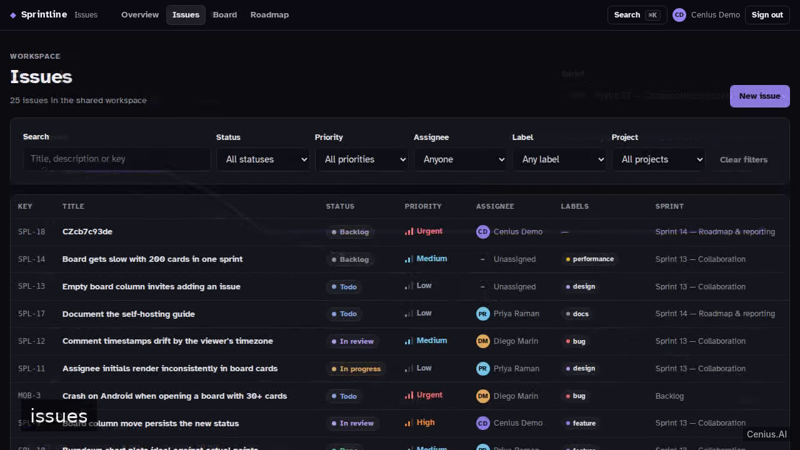
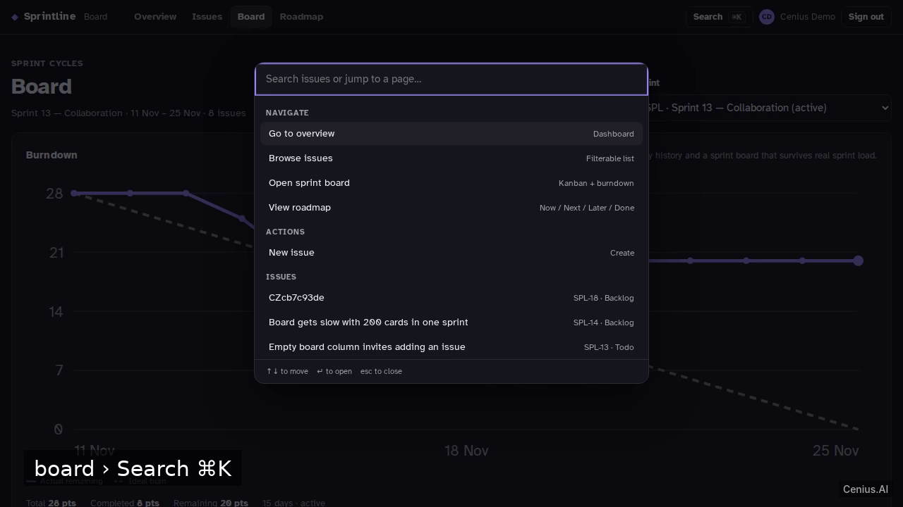

# Sprintline Issue Tracker — complete Vite kanban board example app

Clone it. Run it. Own it. **Sprintline Issue Tracker** is a complete, Apache-2.0-licensed kanban board in Vite — full source, demo data included. Sprintline Issue Tracker is a production-quality open-source-style issue tracker delivered as two services: a FastAPI backend (bcrypt-hashed email/password login, PyJWT session tokens, SQLAlchemy over SQLite persisten…. Self-host Sprintline Issue Tracker on your own infrastructure, or open it on [cenius.ai](https://cenius.ai/marketplace/p/sprintline-issue-tracker?ref=gh&utm_campaign=sprintline-issue-tracker-vite) to request changes and get a Sprintline Issue Tracker fresh build.


[](LICENSE)  [](https://cenius.ai)

[](https://cenius.ai/marketplace/p/sprintline-issue-tracker?ref=gh&utm_campaign=sprintline-issue-tracker-vite)

> **▶ [Open & edit in cenius.ai](https://cenius.ai/marketplace/p/sprintline-issue-tracker?ref=gh&utm_campaign=sprintline-issue-tracker-vite)** — one click to an editable workspace: describe changes in plain English, get an instant preview, one-click deploy and host. Modifications made on the platform come with full rebrand & relicense rights.

_Local clone? See [Quick start](#quick-start) below. cenius.ai is the zero-setup path._

## Demo





▶ **[Video walkthrough](https://cenius.ai/marketplace/p/sprintline-issue-tracker?ref=gh&utm_campaign=sprintline-issue-tracker-vite)** — see the app in action on the cenius.ai project page · [MP4 file](.github/media/demo.mp4)

## Screenshots

  

## Quick start

```bash
./install.sh   # installs dependencies + seeds demo data
```

See [`INSTALL.md`](INSTALL.md) for full setup and usage instructions.

## Features

- Email + password authentication with JWT sessions
- Issues with priority, labels and assignee
- Sprint cycles with board and burndown
- Issue comments and activity history
- Project roadmap view
- Workspace dashboard overview
- Seeded shared demo workspace

## Architecture

Folder layout: `backend/`, `frontend/`, `scripts/`. `install.sh` wires up dependencies and loads seed records; after it runs the app has real data to show. Built in Vite (86 files). Full setup details: [`INSTALL.md`](INSTALL.md).

## Usage guide

Sign in at `/login` with `cenius@cenius.ai` / `cenius` (the credential is printed on the card, and
there is a **Use demo credentials** button that fills it in and signs you in). Everything below
happens in one shared workspace — there are no private projects.

### The workspace overview (`/`)

The landing screen after sign-in. Four tiles count open, in-progress, done and total estimated
points; two bar lists break the same 24 issues down by priority and by assignee (open work only);
the active sprint card shows its goal, how many of its issues are done and which day of the sprint
you are on; the right-hand card lists the eight most recent events across the workspace, each
linking to the issue it happened on. At the bottom, "Assigned to you" lists your own open issues.

### Finding issues (`/issues`)

The list is sorted newest-first and shows key, title, status pill, priority, assignee, label chips
and sprint. Six filters sit above it:

- **Search** — matches title, description and issue key (`SPL-12`). Debounced by 300ms and stored in
  the URL, so a filtered view is shareable.
- **Status / Priority / Assignee / Label / Project** — combinable; *Anyone* and *Unassigned* are
  distinct options on the assignee filter.

Every active filter is echoed under the bar, and **Clear filters** resets all of them. If a filter
combination matches nothing you get "No issues match these filters" with the same reset action; if
the workspace itself is empty you are invited to create the first issue.

### Creating and editing issues

_Full guide: [`USAGE.md`](USAGE.md)_

## FAQ

### How do I self-host Sprintline Issue Tracker?

Clone this repository and run `./install.sh`, then start the app as described in [`INSTALL.md`](INSTALL.md). Sprintline Issue Tracker is fully self-hostable — no external services are required to try it.

### Is it OK to ship Sprintline Issue Tracker as part of a product?

Confirmed free for commercial use — MIT terms let you incorporate, resell, or ship it in any product. [LICENSE](LICENSE).

### How do I customise Sprintline Issue Tracker's branding?

Rebranding is straightforward under the MIT license — change what you want in the source. Or [open it on cenius.ai](https://cenius.ai/marketplace/p/sprintline-issue-tracker?ref=gh&utm_campaign=sprintline-issue-tracker-vite): the platform handles the changes and grants full rebrand rights on the result.

### What if I want to add features to Sprintline Issue Tracker without coding?

The easiest route: [visit the project on cenius.ai](https://cenius.ai/marketplace/p/sprintline-issue-tracker?ref=gh&utm_campaign=sprintline-issue-tracker-vite), tell the platform what to change, and collect the updated build. No source-editing needed.

### How is Sprintline Issue Tracker built technically?

Vite end-to-end. Every file you need to run the app is here in this repository — code, configuration, seed data. Highlights include project roadmap view.

## License & rebranding

Released under the [Apache License 2.0](LICENSE) (© 2026 Cenius AI) — free for personal and commercial use. The Cenius name/logo are trademarks (see NOTICE).

**Need a customized version?** [Remix this app on cenius.ai](https://cenius.ai/marketplace/p/sprintline-issue-tracker?ref=gh&utm_campaign=sprintline-issue-tracker-vite) — modifications made on the platform come with **full rebrand & relicense rights** over your derivative.

## Built with cenius.ai

This entire application — code, design, seeded demo data — was generated on **[cenius.ai](https://cenius.ai)** from a plain-English description.

- 🚀 [Build your own app on cenius.ai](https://cenius.ai)
- 🎛️ [Remix Sprintline Issue Tracker on the marketplace](https://cenius.ai/marketplace/p/sprintline-issue-tracker?ref=gh&utm_campaign=sprintline-issue-tracker-vite) — open it in a workspace, prompt for changes, and ship your own version.

More open-source apps: [the Cenius-ai catalog](https://github.com/Cenius-ai) · [showcase index](https://github.com/Cenius-ai/showcase)
